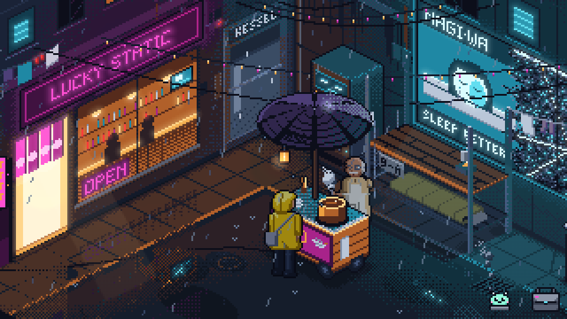

# Glass Sister

Ein eigenständiges Cyberpunk-Point-and-Click-Adventure in Pixel Art, das im Browser läuft.



Nagi·wa ist eine Stadt und zugleich der Konzern, dem sie gehört. Juno ist Hackerin in der Lower Ninth: Sie
beobachtet Menschen durch die Kameras der Stadt und verkauft, was sie dabei erfährt, auf dem Schwarzmarkt.
Vor die Tür geht sie nur, um zu essen und zu handeln. Dann sieht sie eines Nachts ein schweres Verbrechen mit
an. Daraus werden ein moralischer Konflikt und eine Ermittlung, die nach und nach ein viel größeres Geheimnis
freilegt.

Die Stimmung ist von *Dreamweb* inspiriert; Welt, Figuren und Geschichte sind eigene.

## Das Spiel

- **Straße:** isometrische Räume in 320×180, durch die Juno läuft und in denen sie mit Leuten redet.
- **Kameras:** In den Feeds, grün wie alte Phosphor-Monitore, beobachtet sie Menschen bei ihren Abendroutinen.
- **Das Deck:** Junos Computer ist ein eigener Desktop mit Apps für Kameras, Chat, Kassenbuch, Konto, Netz
  und Radio.
- **EVI:** Die kleine KI auf dem Deck redet mit und gibt auf Wunsch Hinweise.
- **Zeit:** Das Spiel läuft über mehrere Abende nach einer Uhr; wer wann wo ist, folgt festen Routinen.
- **Bedienung:** Linksklick handelt, Rechtsklick schaut genauer hin (auf Touch: lange drücken).
- **Gewalt:** Gewaltszenen gibt es in zwei Fassungen, standardmäßig mit schwarzen Balken.


## Stand

Das Spiel ist in Arbeit und geplant sind sechs Kapitel. Bisher gibt es den Text nur auf Deutsch, Englisch soll
später folgen.

| Teil | Stand |
|---|---|
| Intro „Die letzte Schicht“ | fertig |
| Prolog „Nachtschicht“ | spielbar bis zum Ende, geht noch nicht in Kapitel 1 über |
| Kapitel 1 „Glass“ | spielbar, aber großteils Platzhalter-Blöcke und noch nicht vollständig |
| Kapitel 2 bis 6 | nur als Entwurf in der Story-Bibel |

## Spielen

Es gibt keinen Build-Schritt und keine Abhängigkeiten: Repository klonen und `index.html` im Browser öffnen,
auch direkt von der Platte.

| Adresse | Wirkung |
|---|---|
| `index.html` | Titelbild |
| `index.html?act=prolog` | direkt in den Prolog |
| `index.html?act=kapitel1` | direkt in Kapitel 1 |
| `index.html?edit` | der Editor der Engine (auch F10) |

## Technik

Das Spiel läuft auf der eigenen Engine [Cutaway.js](https://github.com/SiENcE/cutaway.js). Sie liegt als
festgepinnte Kopie in `lib/cutaway/` und wird nur in ihrem eigenen Repository geändert. Räume, Figuren und
Dialoge sind Daten, sodass die Werkzeuge jedes Kapitel lesen und durchspielen können: Ein Solver sucht nach
Sackgassen und prüft, ob jeder Zustand einen Hinweis hat. Für die Werkzeuge braucht man Node.

```sh
node lib/cutaway/tools/validate.mjs index.html       # prüft die Spieldaten
node lib/cutaway/tools/solve.mjs index.html --full   # sucht im Prolog nach Sackgassen
node lib/cutaway/tools/play.mjs index.html           # spielt den Prolog mit echten Klicks durch
sh tools/check.sh                                    # alle Prüfungen (etwa zehn Minuten)
```

Die Grafik entsteht mit pxl aus Quelltexten in `art/`; die fertigen Atlanten liegen in `assets/`, damit
das Spiel ohne Node läuft. Wer die Grafik neu bauen will, braucht zusätzlich den pxl-Skill, der ein eigenes
Repository ist und hier nicht mitkommt.

## Dokumente

Vorsicht: Die Dokumente verraten die ganze Geschichte.

| Datei | Inhalt |
|---|---|
| [`CLAUDE.md`](CLAUDE.md) | Aufbau des Projekts, Regeln und Befehle |
| [`docs/PLAN.md`](docs/PLAN.md) | Bauplan und aktueller Stand (englisch) |
| [`docs/story.md`](docs/story.md) | Story-Bibel: Welt, Figuren, Geheimnis, Kapitel, Enden |
| [`docs/style-guide.md`](docs/style-guide.md) | Grafik und Oberfläche (englisch) |
| [`docs/dialog-style-guide.md`](docs/dialog-style-guide.md) | Wie alle Texte klingen |

## Lizenz

Cutaway.js steht unter der MIT-Lizenz ([`lib/cutaway/LICENSE`](lib/cutaway/LICENSE)). Für das Spiel selbst ist
noch keine Lizenz festgelegt.
