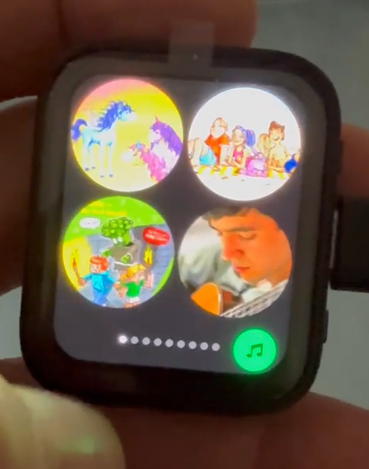
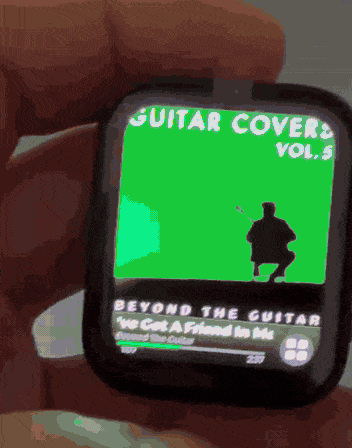

# Bop

Bop is a source-only Spotify remote for children, built on the [Waveshare ESP32-S3 Touch AMOLED 1.8 board](https://www.waveshare.com/esp32-s3-touch-amoled-1.8.htm).

A child picks music from a grid of album covers and artist pictures, with no reading needed. Parents curate that grid in the Spotify app: every artist the account follows and every album it saves appears on Bop. The now-playing screen shows the current track and controls play, pause, skip, and volume.

Bop plays no sound itself. It tells a Spotify speaker, phone, or tablet what to play.

    
    

[See Bop in action on X.](https://x.com/mark_a_phelps/status/2087217997429571717?s=20)

## Kid mode

Bop starts on a grid of pictures from the Spotify library, so a child who
cannot read yet can pick music:

- **Artists you follow** show first, as round pictures. A tap opens that
  artist's albums. Only regular albums appear, so every episode of an audio
  drama series does, while singles and compilations stay hidden.
- **Albums you saved** follow, as square covers. A tap plays the album.

To change what the children see, follow or unfollow an artist, or save or
remove an album, in the Spotify app. Bop reads the library again every three
hours, and when the grid opens at most every half hour, and checks each
artist's albums once a day. Restart Bop to see a change at once. It shows up
to 48 artists, up to 144 entries in all, and up to 200 albums of one artist.

Bop keeps the library, the albums of every followed artist, and the pictures
in its flash memory, so the grid and every artist open at once, also while
the WiFi is down. Playing an album needs WiFi. Without it, Bop shows
`Connecting to WiFi...` at the top and a big **WAIT** on a tapped cover, and
plays nothing until the child taps again with WiFi back.

The grid shows the whole library of the account. To keep your own music out
of it, provision Bop with a separate Spotify account for the children.

A tapped album plays from its first track, in order, on the active Spotify
device. Bop is a remote and plays no sound, so a speaker, phone, or tablet
must be available to Spotify. When no device is active, Bop uses the first
available one.

| Gesture on the grid | Action |
| --- | --- |
| Tap a round artist picture | Show that artist's albums |
| Tap a square album cover | Play that album |
| Tap the playing album's cover | Pause or resume it ⏸️ / ▶️ |
| Swipe left or right | Next or previous page |
| Tap the arrow button, or swipe right on an artist's first page | Return from an artist to the library |
| Tap the green note button | Return to the playing album |

The cover of the playing album shows a translucent pause mark while it plays
and a play mark while it is paused.

The now-playing screen keeps the gestures below. The button with four squares,
right of the title, returns to the album grid. When an album ends, Bop returns
to the grid by itself.

## Touch controls

Use these gestures on the now-playing screen:

| Gesture | Action |
| --- | --- |
| Swipe left | Previous track ⏮️ |
| Swipe right | Next track ⏭️ |
| Drag up | Increase volume 🔊 |
| Drag down | Decrease volume 🔉 |
| Short press | Play or pause ▶️ / ⏸️ |
| Tap the four-squares button | Return to the album grid |
| Long press | Show the Spotify screen with a QR code for the current track 🎵 |

Tap the Spotify screen to return to the current track.

    

After 30 seconds without a touch, a dim drifting clock replaces the screen to
protect the AMOLED panel, also while music plays, and after 2 minutes the
screen goes dark. A touch, or picking up or tilting the board, wakes it; that
first touch does nothing else. The clock shows UTC unless you set your time
zone, as [INSTALL.md](INSTALL.md) describes.

## Project status

Bop is source software for personal experimentation. It is not an official Spotify product.

This repository provides no firmware binary, package, GitHub Release, release tag, or shared Spotify client ID. You build the firmware and create your own Spotify application.

Spotify restricts Streaming integrations to its Approved Devices. Spotify terms do not clearly state how that restriction applies to a source-only ESP32 repository. Bop makes no claim of Spotify approval.

## Hardware and account requirements

You need these items:

- A Waveshare ESP32-S3 Touch AMOLED 1.8 board.
- A USB data cable.
- A macOS, Linux, or Windows host computer.
- A WiFi network.
- A Spotify Premium account.
- Your own Spotify application and Client ID.
- Optional: a FAT32 microSD card, inserted before Bop starts. Bop writes its
  log there and keeps the grid pictures that no longer fit its flash cache.

## Support levels

| Host | Support level |
| --- | --- |
| macOS | Hardware-tested installation |
| Linux | Firmware builds in CI |
| Windows | Host tools support it. Hardware installation is untested. |

CI runs on Linux only. Use macOS for the supported hardware procedure.

## Quick start

1. Install Git and [mise](https://mise.jdx.dev/).
2. Run `git clone https://github.com/markphelps/bop-esp32.git`.
3. Run `cd bop-esp32`.
4. Read [INSTALL.md](INSTALL.md), [EULA.md](EULA.md), and [PRIVACY.md](PRIVACY.md).
5. Connect the board with a USB data cable.
6. Run `mise install`.
7. Run `mise run flash` without `--force`.
8. Scan the QR code on Bop and join the **Bop setup AP**.
9. Use the **captive portal** to save WiFi.
10. Run the USB provisioning command, `mise run provision`.
11. Enter the Spotify Client ID and complete Spotify authorization.

The first flash takes a credential-free factory backup. The captive portal then writes only the verified WiFi values.

The USB provisioning command queries the device state, then sends only the Spotify Client ID and refresh token. It never reads or rewrites WiFi values.

CAUTION: Do not use `mise run flash -- --force` for the first flash. It takes no backup. After portal setup, `mise run provision` cannot make its required credential-free backup.

If a valid backup exists, the backup task validates it and does not read the board. If an incomplete or invalid backup exists, the task stops. Move that backup out of `backups/` before you try again.

If no backup exists, the task reads the credential partition first. It reads all flash only when the partition has no credentials.

## Documents

- [INSTALL.md](INSTALL.md) gives the installation, update, removal, and factory-recovery procedures.
- [docs/HOW-IT-WORKS.md](docs/HOW-IT-WORKS.md) explains the hardware, firmware, data flow, and every `mise` task.
- [docs/TROUBLESHOOTING.md](docs/TROUBLESHOOTING.md) lists recovery steps for common device and provisioning problems.
- [CONTRIBUTING.md](CONTRIBUTING.md) explains the contribution workflow, checks, and pull-request requirements.
- [SECURITY.md](SECURITY.md) explains the security policy and the plaintext NVS credential risk.
- [EULA.md](EULA.md) and [PRIVACY.md](PRIVACY.md) describe the terms and data use.
- [THIRD_PARTY_LICENSES.md](THIRD_PARTY_LICENSES.md) lists third-party components and their licenses.

## Security

Bop stores WiFi values, the Spotify Client ID, and the Spotify refresh token as plaintext in device NVS.

A person with physical access to the board can read these values. Read [SECURITY.md](SECURITY.md) before you provision the device.

Run `mise run deprovision` before you give away, sell, or discard the board. The command removes device credentials after you remove Bop access from Spotify.

A microSD card holds no credentials, but its log names the tracks that played. Remove the card, or delete its `bop` folder, before you give the board away.

## License and trademarks

Project code uses the Apache License 2.0. Read [LICENSE](LICENSE).

The Montserrat font uses the SIL Open Font License. Read [THIRD_PARTY_LICENSES.md](THIRD_PARTY_LICENSES.md).

Bop is an independent project. Spotify is a trademark of Spotify AB. Espressif, ESP32, and Waveshare are trademarks of their respective owners.
