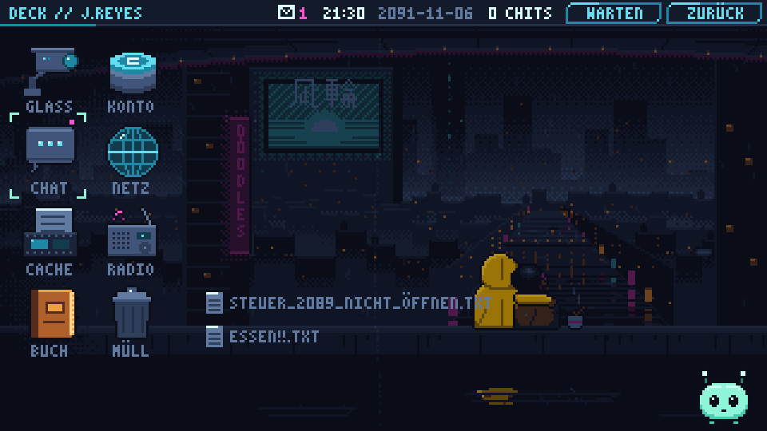

# Glass Sister

Ein eigenständiges Cyberpunk-Point-and-Click-Adventure in Pixel Art, das im Browser läuft.


Nagi·wa ist eine Stadt und zugleich der Konzern, dem sie gehört. Juno ist Hackerin in der Lower Ninth: Sie
beobachtet Menschen durch die Kameras der Stadt und verkauft, was sie dabei erfährt, auf dem Schwarzmarkt.
Vor die Tür geht sie nur, um zu essen und zu handeln. Dann sieht sie eines Nachts ein schweres Verbrechen mit
an. Daraus werden ein moralischer Konflikt und eine Ermittlung, die nach und nach ein viel größeres Geheimnis
freilegt.

Die Stimmung ist von *Dreamweb* inspiriert; Welt, Figuren und Geschichte sind eigene.

## Das Spiel

- **Straße:** isometrische Räume in 320×180, durch die Juno läuft und in denen sie mit Leuten redet.
- **Kameras:** In den Feeds, grün wie alte Phosphor-Monitore, beobachtet sie Menschen bei ihren Abendroutinen.
- **Das Deck:** Junos Computer ist ein eigener Desktop mit Apps für Kameras, Chat, Kassenbuch, Konto, Netz
  und Radio.
- **EVI:** Die kleine KI auf dem Deck redet mit und gibt auf Wunsch Hinweise.
- **Zeit:** Das Spiel läuft über mehrere Abende nach einer Uhr; wer wann wo ist, folgt festen Routinen.
- **Bedienung:** Linksklick handelt, Rechtsklick schaut genauer hin (auf Touch: lange drücken).
- **Gewalt:** Gewaltszenen gibt es in zwei Fassungen, standardmäßig mit schwarzen Balken.



## Stand

Das Spiel ist in Arbeit und geplant sind sechs Kapitel. Bisher gibt es den Text nur auf Deutsch, Englisch soll
später folgen.

| Teil | Stand |
|---|---|
| Intro „Die letzte Schicht“ | fertig |
| Prolog „Nachtschicht“ | spielbar bis zum Ende, geht in Kapitel 1 über |
| Kapitel 1 „Glass“ | von Anfang bis Ende spielbar, aber großteils noch Platzhalter-Blöcke; das Ende in cam31 ist gemalt |
| Kapitel 2 bis 6 | nur als Entwurf in der Story-Bibel |

## Spielen

Es gibt keinen Build-Schritt und keine Abhängigkeiten: Repository klonen und `index.html` im Browser öffnen,
auch direkt von der Platte.

| Adresse | Wirkung |
|---|---|
| `index.html` | Titelbild |
| `index.html?act=prolog` | direkt in den Prolog |
| `index.html?act=kapitel1` | direkt in Kapitel 1 |
| `index.html?edit` | der Editor der Engine (auch F10), ohne Speichern in den Spielordner |

Der Editor mit allem, was er kann (speichert direkt ins Spiel, startet Prüfungen und Grafik-Builds, hat die
Reiter des Spiels wie **Iso**), läuft über das Studio, einen kleinen Server nur auf dem eigenen Rechner:

```sh
node lib/cutaway/tools/studio.mjs      # im Spielordner; öffnet das Spiel mit dem Editor im Browser
```

Oben rechts im Editor zeigt **studio ●** (grün), dass das Studio verbunden ist. Steht dort **studio ○**, fehlt
die Verbindung, und damit auch der Reiter Iso und das Speichern ins Spiel; der Editor sagt dann links unter den
Arbeitsbereichen und in der Statuszeile, warum:

- **Als Datei geöffnet** (`file://…/index.html?edit` oder F10): Das Studio starten, wie oben.
- **Adresse ohne Schlüssel** (`http://127.0.0.1:7400/index.html?edit`): Die Seite muss mit der Adresse geöffnet
  werden, die das Studio in seiner Konsole ausgibt, `…/index.html?edit&studio=<schlüssel>`; der Schlüssel ist das
  Passwort der Seite. Kopieren und im Browser öffnen, oder das Studio neu starten.
- **Altes Studio:** Ein Studio, das vor einer neuen Engine-Version gestartet wurde, mit Strg+C beenden und neu
  starten.

## Technik

Das Spiel läuft auf der eigenen Engine [Cutaway.js](https://github.com/SiENcE/cutaway.js). Sie liegt als
festgepinnte Kopie in `lib/cutaway/` und wird nur in ihrem eigenen Repository geändert. Räume, Figuren und
Dialoge sind Daten, sodass die Werkzeuge jedes Kapitel lesen und durchspielen können: Ein Solver sucht nach
Sackgassen und prüft, ob jeder Zustand einen Hinweis hat. Für die Werkzeuge braucht man Node.

```sh
node lib/cutaway/tools/validate.mjs index.html                         # prüft die Spieldaten
node tools/solve-act.mjs prolog --full --set off_roof                  # sucht im Prolog nach Sackgassen
node lib/cutaway/tools/play.mjs index.html --path tools/paths/spiel.json   # spielt das ganze Spiel mit echten Klicks durch
sh tools/check.sh                                                      # alle Prüfungen (etwa zehn Minuten)
```

### Die Zusammenhänge ansehen

Der Solver kann beim Durchsuchen mitschreiben, was jeder Zug braucht und was er herbeiführt. Daraus entsteht
ein Rätsel-Abhängigkeitsgraph: die Schritte als Kästen in der Farbe ihres Raums, die Fakten (Flags,
Gegenstände, besuchte Räume) dazwischen, der gewonnene Weg nummeriert. Ein Klick auf einen Schritt oder ein
Fakt zeigt, was davor nötig ist und was danach aufgeht. Dazu kommt das Zustands-Budget: welches Flag die Zahl
der Zustände wie stark vervielfacht.

```sh
sh tools/graph.sh prolog     # der Prolog          → build/graph/prolog.js          (etwa 3½ Minuten)
sh tools/graph.sh main       # Kapitel 1, Hauptfaden → build/graph/kapitel1_main.js (etwa 1¼ Minuten)
sh tools/graph.sh varga      # ein Nebenfaden allein → build/graph/kapitel1_varga.js
```

Jeder Lauf gibt am Ende einen Link aus, der den Graphen als eigene Seite öffnet (auch direkt von der Platte).
Im Editor ist es der Reiter **Connections**: Mit dem Studio stehen dort die Dateien aus `build/graph/` und
die Knöpfe „graph: prolog“ und „graph: kapitel1 main“, die die Daten neu erzeugen; ohne Studio lädt
„Load a file …“ eine fertige Datei. Von einem Schritt springt „Open in Things“ zu seinem Hotspot und dem
Skript, das der Zug ausführt; ein Fakt listet jede Stelle, die es setzt oder abfragt.

### Räume im Editor

Mit dem Studio hat der Editor zwei Reiter für die Räume. **Map** zeigt alle Räume als Bilder mit ihren
Ausgängen und Skript-Warps, dazu, was vom Start aus nicht erreichbar ist und welche Wege ins Leere führen.
**Iso** bearbeitet die Karte eines Straßen-Raums (`art/rooms/<id>.map.js`) direkt über seinem Bild:
Wände, Requisiten, Türen und Fenster, die Treppe, Sperrflächen, Spots und Lampen anlegen, verschieben und
löschen, den Boden mit den Schlüsseln des Kits bemalen, die Größe des Raums und jeden übrigen Wert der Karte im
Inspektor ändern. „Save“ schreibt nur die geänderten Werte zurück (Kommentare bleiben), „Bake“
baut den Raum neu und lädt die Grafik. „Where from?“ (oder Alt+Klick) auf ein Pixel nennt das Teil der
Karte und das Kit-Stück, das es gemalt hat, und öffnet die Zeile im Quelltext. Die Hintergründe bleiben so
Code: Gemalt wird im Kit, nicht in den Pixeln. Die Anleitung steht in [`docs/editor-iso.md`](docs/editor-iso.md)
und im Editor unter F1, wenn der Reiter offen ist.

Die Grafik entsteht mit pxl aus Quelltexten in `art/`; die fertigen Atlanten liegen in `assets/`, damit
das Spiel ohne Node läuft. Wer die Grafik neu bauen will, braucht zusätzlich den pxl-Skill, der ein eigenes
Repository ist und hier nicht mitkommt.

## Dokumente

Vorsicht: Die Dokumente verraten die ganze Geschichte.

| Datei | Inhalt |
|---|---|
| [`CLAUDE.md`](CLAUDE.md) | Aufbau des Projekts, Regeln und Befehle |
| [`docs/PLAN.md`](docs/PLAN.md) | Bauplan und aktueller Stand (englisch) |
| [`docs/story.md`](docs/story.md) | Story-Bibel: Welt, Figuren, Geheimnis, Kapitel, Enden |
| [`docs/style-guide.md`](docs/style-guide.md) | Grafik und Oberfläche (englisch) |
| [`docs/dialog-style-guide.md`](docs/dialog-style-guide.md) | Wie alle Texte klingen |

## Lizenz

Cutaway.js steht unter der MIT-Lizenz ([`lib/cutaway/LICENSE`](lib/cutaway/LICENSE)). Für das Spiel selbst ist
noch keine Lizenz festgelegt.
